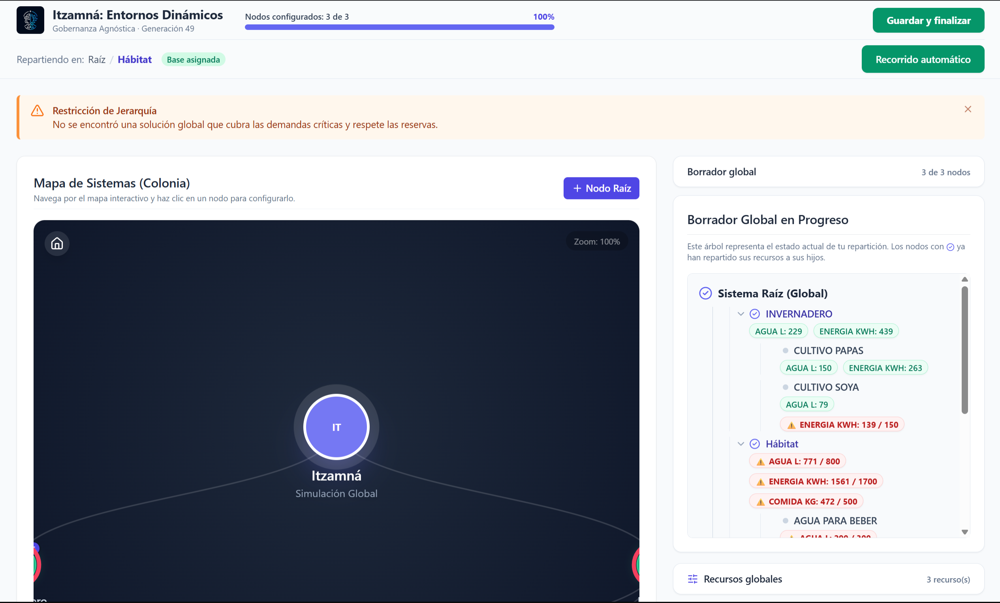
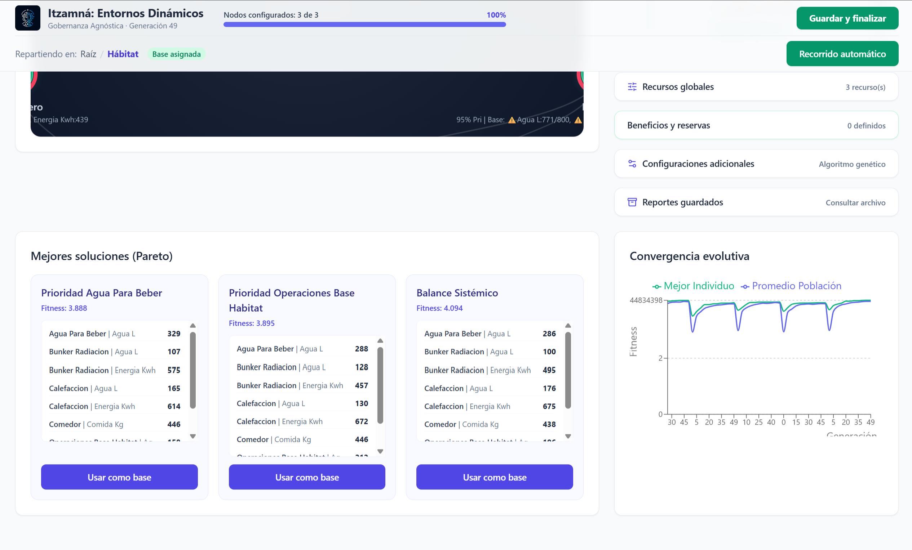
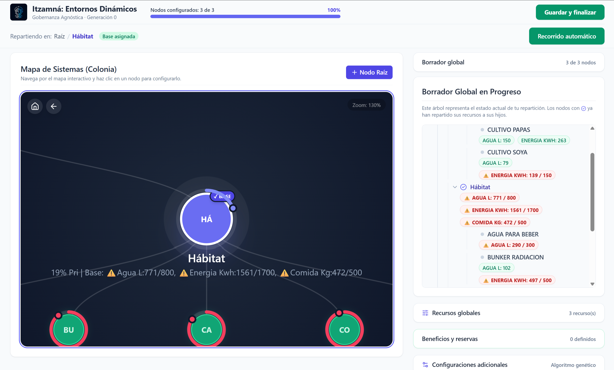
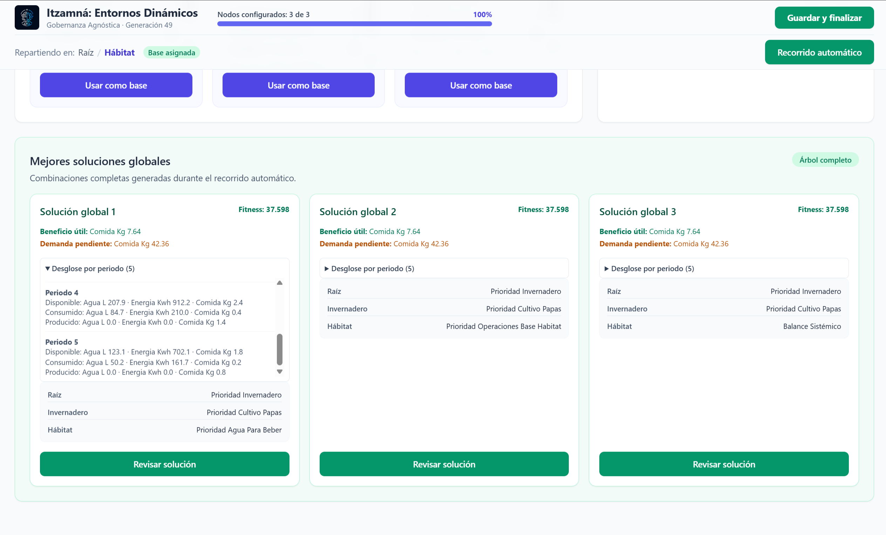
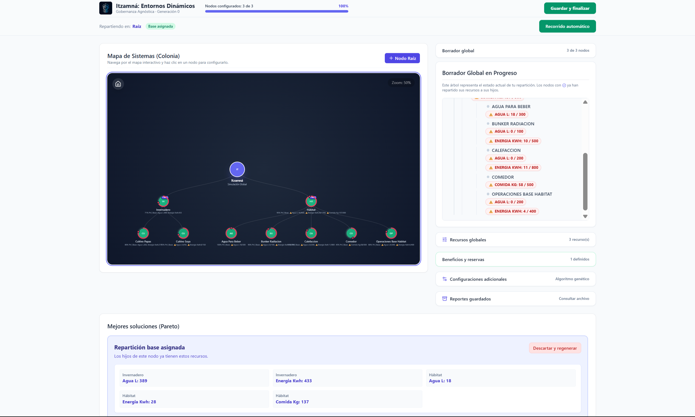

# Pitch: Proyecto 8D — Gobernanza y Recursos
**Duración objetivo:** 5:00 minutos
**Metodología:** Leer el texto a un ritmo pausado y natural (~130 palabras por minuto). Cambiar de diapositiva en las marcas indicadas.

---

## Diapositiva 1: Apertura impactante (⏱️ 0:00 - 0:45)

### Texto en pantalla
* Proyecto 8D. En Marte, el pánico mata más rápido que la asfixia.

### Guión del orador
> "Imaginen que están a 225 millones de kilómetros de casa. Es martes por la mañana en la colonia y los sistemas reportan una fuga que reduce nuestras reservas de agua y oxígeno en un 40%. Tienen 10 minutos para decidir a qué módulos se les corta el soporte vital y a cuáles no. ¿Quién toma la decisión? ¿Bajo qué criterio? En situaciones de escasez extrema, una mala decisión no cuesta dinero; cuesta vidas. Buenos días, somos el equipo del Proyecto 8D, y hoy vamos a resolver el problema más crítico de la exploración espacial: cómo gobernar lo impredecible."

---

## Diapositiva 2: Problemática y datos (⏱️ 0:45 - 1:45)

### Texto en pantalla
* El Reto: La escasez física provoca colapso social.

### Guión del orador
> "Al analizar este reto bajo la metodología de los 5 Por Qué, llegamos a un dato duro e incómodo. ¿Por qué muere una colonia? No es por la falta inicial de un recurso. Muere porque el pánico rompe la cadena de mando. Cuando los suministros caen, si la distribución se hace de forma manual, sesgada u oculta, la confianza desaparece. Y sin confianza, hay motines, acaparamiento y colapso. Alternativas actuales como el 'racionamiento estricto fijo' son inflexibles ante emergencias dinámicas. Y un 'comité humano' es demasiado lento y susceptible al sesgo cuando hay vidas en juego. Necesitábamos algo más rápido, justo y, sobre todo, transparente."

---

## Diapositiva 3: La solución (⏱️ 1:45 - 3:00)

### Texto en pantalla
* Gobernanza Paramétrica: Motor Genético + Óptimo de Pareto.

### Guión del orador
> "Nuestra solución es el Proyecto 8D: el primer sistema de Gobernanza Paramétrica y Asignación Dinámica. ¿Cómo funciona? Hemos sacado el error humano de la ecuación. En lugar de debatir quién recibe agua, nuestro sistema utiliza un motor genético avanzado en el backend. Cuando hay una crisis, este algoritmo evalúa millones de combinaciones de distribución en segundos, buscando el 'Óptimo de Pareto': el punto matemático exacto donde maximizamos la supervivencia global sin perjudicar injustamente a ningún sector. A diferencia de un racionamiento ciego, el Proyecto 8D prioriza inteligentemente variables como el soporte vital de la tripulación y los cultivos hidropónicos por encima de la manufactura no esencial."

---

## Diapositiva 4: El prototipo (⏱️ 3:00 - 4:00)

### Texto en pantalla
* Recalibración en milisegundos. 100% Auditable.

### Guión del orador
> "Observemos el prototipo funcional en pantalla. Esto es lo que verían los colonos. En el momento en que simulamos una caída de energía, la plataforma reacciona instantáneamente. El 'Resource Lock' bloquea la energía de sistemas secundarios y la redirige a los escudos térmicos. Pero la verdadera magia está aquí, en la vista de reportes de distribución. Cada litro de agua reasignado genera un registro auditable. Todos en la colonia pueden ver en sus pantallas, en tiempo real, *por qué* sus raciones cambiaron. No hay secretos. Transformamos una decisión matemática en cohesión social y paz mental."

---

## Diapositiva 5: Viabilidad (⏱️ 4:00 - 4:30)

### Texto en pantalla
* Viabilidad: Despliegue ágil, bajo costo computacional, máxima confianza.

### Guión del orador
> "Desde la perspectiva de nuestro modelo Canvas, este proyecto es altamente viable hoy. Nuestra propuesta de valor central es 'Confianza como Servicio'. A nivel de infraestructura, está construido con Next.js y Python, garantizando un despliegue ligero que no requiere supercomputadoras para correr. Su costo de mantenimiento y actualizaciones es marginal, pero el valor que protege —la infraestructura de toda una misión de miles de millones de dólares— es incalculable."

---

## Diapositiva 6: Retorno a la humanidad (⏱️ 4:30 - 5:00)

### Texto en pantalla
* De Marte a la Tierra: ODS 6 (Agua) y ODS 16 (Paz e Instituciones).

### Guión del orador
> "Pero la tecnología del Proyecto 8D no tiene que esperar a que colonicemos Marte para ser útil. Hoy, en la Tierra, nos enfrentamos a escasez severa. Este mismo motor genético puede usarse para optimizar y transparentar la logística de recursos en campos de refugiados, zonas de desastre natural o regiones con estrés hídrico. Impactamos directamente los ODS 6 de Agua Limpia y 16 de Instituciones Sólidas. Al diseñar una forma justa de sobrevivir en Marte, hemos creado la herramienta para salvar vidas, hoy, en la Tierra. Muchas gracias."
